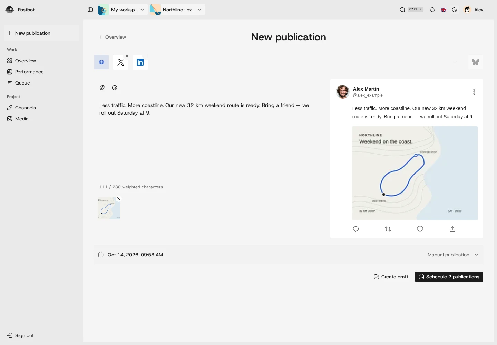

# Postdot

Self-hosted social publishing for people and their agents.

Write a post, adapt it for each destination, and schedule publication from one
workspace. Use Studio in your browser, or work through the CLI and HTTP API.



## What you can do

- Prepare text, images and video, with separate content and schedules per channel.
- Publish through connected accounts, track manual destinations, or deliver to
  custom HTTP endpoints.
- Organize work across projects with roles, a media library, a calendar and a queue.
- Read collected performance metrics and export them as CSV. Provider coverage
  varies; see the [capability matrix](docs/capability-evidence.md).

Postdot runs its API, dashboard, scheduler and publication worker in one service,
with SQLite and local media storage. S3-compatible media storage is optional.

**Early development.** There is no published container release or supported upgrade
path yet. The project is being renamed from Postbot. Environment variables, stored protocol
identifiers and the screenshot retain that name during the [transition](docs/project/identity-transition.md).

## Run it yourself

Start with the [Docker Compose installation guide](docs/deployment/self-hosting.md).
It covers building from source, generating secrets, creating the first account and
protecting your data. Check the [provider requirements](docs/deployment/provider-requirements.md)
before connecting an account.

## Develop locally

Install [Bun](https://bun.sh) 1.4.2 or newer, then run:

```sh
bun install
cp apps/api/.env.example apps/api/.env
cp apps/web/.env.example apps/web/.env
openssl rand -hex 32
openssl rand -hex 32
openssl rand -hex 32
```

Paste those three independent values into `BETTER_AUTH_SECRET`,
`POSTBOT_MEDIA_PUBLIC_URL_SECRET` and `POSTBOT_PUBLISHER_ENCRYPTION_KEY`, respectively,
in `apps/api/.env`. Keep that file private. Then start the application:

```sh
bun run dev
```

Open Studio at <http://localhost:5173> and create the first account to claim the
instance. The API listens on port 3000 and exposes its interactive reference at
<http://localhost:3000/openapi>.

See the [development reference](docs/development.md) for alternate ports, email,
CLI usage and validation commands.

## Documentation

- [Installation and operation](docs/deployment/self-hosting.md)
- [CLI publication workflows](docs/cli-publications.md)
- [Security policy](SECURITY.md)
- [User API keys](docs/security/user-api-keys.md)
- [Backup and restoration](docs/deployment/backup-and-restoration-boundary.md)
- [Runtime and release status](docs/deployment/runtime-and-distribution.md)

## License

Copyright (c) 2026 Hakim Saoudi. Original code is licensed under
[AGPL-3.0-only](LICENSE). Third-party code and assets keep their own licenses;
see [THIRD_PARTY_NOTICES.md](THIRD_PARTY_NOTICES.md).
