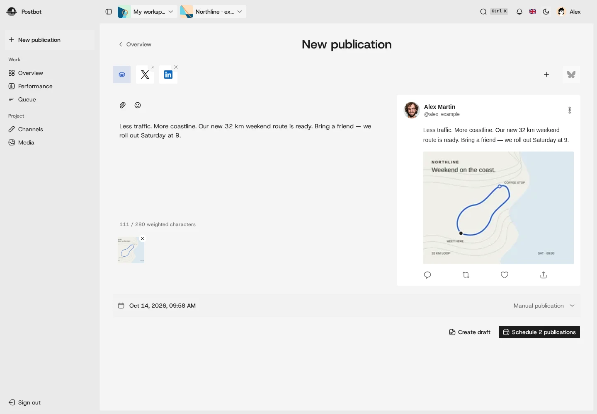

  

<h1 align="center">Postdot</h1>

Self-hosted social publishing for you and your agents.

  <a href="https://postdot.app/docs/installation/">Get started</a> ·
  <a href="https://postdot.app">Website</a> ·
  <a href="https://postdot.app/docs/">Documentation</a> ·
  <a href="https://postdot.app/docs/releases/">Release notes</a>

Write, adapt and schedule publications across your channels. Use Studio in your
browser, connect your agent, or build publishing into your own workflows.

- **Publishing:** separate text, media and schedules for each destination, with
  automated and manual channels in the same calendar.
- **Organization:** projects, shared channels, a media library and a publication queue.
- **Integrations:** [CLI](integrations/cli/), [API](https://postdot.app/docs/reference/),
  [MCP](https://postdot.app/docs/mcp/), [agent skills](skills/) and [n8n](integrations/n8n/).
- **Languages:** English, French, Spanish and German in Studio.

## Self-hosting

Use SQLite or PostgreSQL with the same Docker image. Keep media locally or in
S3-compatible storage, and [move between them](https://postdot.app/docs/transfer/)
as your setup changes. The dashboard, API, scheduler and publication worker run
in one service; [coordinated instances](https://postdot.app/docs/postgresql/) are
available with PostgreSQL and S3.

Start with the [Docker Compose guide](https://postdot.app/docs/installation/)
and check the [account requirements](https://postdot.app/docs/provider-configuration/)
for the platforms you want to connect. Postdot is in alpha;
[release notes](https://postdot.app/docs/releases/) cover changes and upgrades.

## Development and support

[Contributing](CONTRIBUTING.md) ·
[Development setup](https://postdot.app/docs/contributing/) ·
[Report a bug](https://github.com/postdot/postdot/issues) ·
[Discussions](https://github.com/postdot/postdot/discussions) ·
[Security](SECURITY.md)

Licensed under [AGPL-3.0-only](LICENSE).
See [third-party notices](THIRD_PARTY_NOTICES.md) for other code and assets.
